<!--
  The cards in assets/ are drawn by scripts/build_assets.py. Every Monday
  .github/workflows/refresh.yml redraws them and rewrites the generated
  blocks below (between the start/end markers), so edit around those.
-->

<a href="https://majid.ninja">
  <picture>
    <source media="(prefers-color-scheme: dark)" srcset="assets/hero-dark.svg">
    
  </picture>
</a>

<p align="center">
  <a href="https://majid.ninja"></a>
  <a href="https://gitlab.com/majidninja"></a>
</p>

### Hi, I'm Majid 👋

I run servers and keep them running. That means DevOps, Linux, and a fair amount of security work, because a server that's up but owned isn't really up.

- **Day to day:** deploys, CI pipelines, hardening boxes, and reading logs at hours when nobody should be reading logs.
- **Lately:** writing small Rust tools for the problems I keep running into on Linux machines.
- **Ask me about:** Linux servers, CI/CD, locking down SSH, or why the thing that worked yesterday doesn't work today.

<!-- stats-card:start -->
<a href="https://github.com/search?q=author%3Amajidninja+is%3Apr+is%3Amerged+-user%3Amajidninja&amp;type=pullrequests">
  <picture>
    <source media="(prefers-color-scheme: dark)" srcset="assets/stats-dark.svg">
    
  </picture>
</a>
<!-- stats-card:end -->

## Things I've built

**[whatchanged](https://github.com/majidninja/whatchanged)** &nbsp;
[](https://github.com/majidninja/whatchanged/releases/latest)<br>
Something on your Linux box broke and it worked yesterday. `whatchanged --since yesterday` puts package upgrades, edited configs, new services and cron changes on one timeline, so you can see what moved. Read-only, no daemon, no network.

**[whatchanged-action](https://github.com/majidninja/whatchanged-action)**<br>
The same idea for CI: a GitHub Action that shows what a job changed on its runner (packages, `/etc`, systemd, cron). Useful when a pipeline passes and then the next one mysteriously doesn't.

**[rotcheck](https://github.com/majidninja/rotcheck)** &nbsp;
[](https://github.com/majidninja/rotcheck/releases/latest)<br>
Disks flip bits quietly, and you usually find out years later when an old photo won't open. rotcheck records a checksum for every file in the folders you care about and tells you what went missing, changed or rotted. Offline, zero dependencies, `sha256sum`-compatible manifests.

## Upstream

Merged pull requests in other people's projects. This table updates itself every week.

<!-- upstream:start -->
| Project | Merged PRs | Most recent |
| --- | --- | --- |
| [AndreaBozzo/dataprof](https://github.com/AndreaBozzo/dataprof) | 9 | [#1184](https://github.com/AndreaBozzo/dataprof/pull/1184) test(python): leave execution_time_ms out of the arrow stream quality comparison |
| [CrossGL/crosstl](https://github.com/CrossGL/crosstl) | 1 | [#3663](https://github.com/CrossGL/crosstl/pull/3663) fix(opencl): number program-scope __constant bindings before kernel buffers |
| [nikhilb2/simple_invoicing](https://github.com/nikhilb2/simple_invoicing) | 1 | [#617](https://github.com/nikhilb2/simple_invoicing/pull/617) fix(backend): sort GSTR-1 Table 13 document numbers naturally |
| [skdas20/VaultX](https://github.com/skdas20/VaultX) | 2 | [#15](https://github.com/skdas20/VaultX/pull/15) fix(storage): create the vault and session cache owner-only |
| [ludo-technologies/pyscn](https://github.com/ludo-technologies/pyscn) | 1 | [#864](https://github.com/ludo-technologies/pyscn/pull/864) fix: report clone fragment complexity (#860) |
| [ansible/receptor](https://github.com/ansible/receptor) | 1 | [#1612](https://github.com/ansible/receptor/pull/1612) fix(receptorctl): ignore leading v when comparing versions |
| [storytold/pdfcraft](https://github.com/storytold/pdfcraft) | 1 | [#3325](https://github.com/storytold/pdfcraft/pull/3325) Rail: scroll the panel buttons above the page navigation in short windows (#3282) |
<!-- upstream:end -->

## Off the keyboard

Well, mostly still on it.

- **Bash scripts for fun.** If I do something twice, the third time is a script. Some of them are even a good idea.
- **Hardware.** I build, fix and upgrade machines, and I'd rather open the case than open a ticket.
- **Gaming.** Same rule as production: low latency, high uptime, and blame the network when I lose.

```bash
while true; do coffee && deploy || rollback; sleep 8h; done
```

<p align="center">
  
</p>
